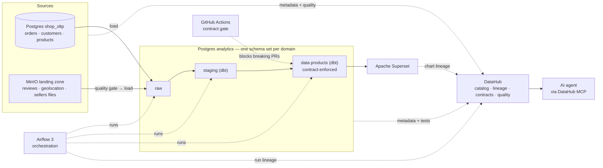

# Data Governance Portfolio — Data Mesh on Open Source

A data platform built on **data mesh** principles where **governance is built in, not bolted on**.
Every dataset — from a raw file in the landing zone to a dashboard chart — is owned by a domain,
described by a contract, checked for quality, and traceable through lineage in the catalog.
AI sits on top and answers questions only from governed, certified data products.

Built entirely with open-source tools on the public
[Olist Brazilian E-Commerce dataset](https://www.kaggle.com/datasets/olistbr/brazilian-ecommerce).

> **Built to be promoted, not just demoed.** The local setup runs in Docker, and every
> component has a documented production configuration and disaster-recovery plan —
> see [Production readiness](docs/production-readiness.md) and
> [Disaster recovery](docs/disaster-recovery.md).

---

## Data mesh in this project

| Principle | Implementation |
|---|---|
| **Domain ownership** | Four domains — Sales, Customer, Marketplace, Customer Experience — each owning its sources, contracts, dbt project and data products |
| **Data as a product** | Each domain publishes data products with an ODCS contract, an owner, an SLA and a certification status in DataHub |
| **Self-serve platform** | `platform/` provides shared storage, orchestration, ingestion, quality and cataloging — domains plug in without touching infrastructure |
| **Federated computational governance** | `governance/` defines global standards and policies as code, enforced automatically in CI on every domain |

Details: [docs/data-mesh.md](docs/data-mesh.md)

---

## What this project demonstrates

| Governance capability | How it is shown |
|---|---|
| **Data contracts** | Every dataset — landing files, source tables, warehouse models — has an [ODCS](https://bitol-io.github.io/open-data-contract-standard/) contract |
| **Quality at every layer** | Landing-zone files are tested *before* they are loaded; source tables and dbt models are tested against their contracts |
| **Breaking-change protection** | A pull request that breaks a contract is blocked, and the consuming domains are alerted |
| **Cross-platform lineage** | Navigate in DataHub from a raw file in object storage → source DB → warehouse → dashboard |
| **Ownership & semantics** | Domains, data products, owners and glossary terms published to the catalog |
| **Governed AI** | An AI agent answers questions through the catalog (MCP), using certified data products only |
| **Production readiness** | Hardened configuration, secrets management, least-privilege access, backups and tested restores |

Every claim above is backed by a reproducible scenario — see [Proofs](docs/proofs.md).

---

## Architecture



Three storage platforms are used on purpose — **MinIO (S3)**, **Postgres `shop_oltp`** and
**Postgres `analytics`** — so lineage crosses real platform boundaries, as it does in a company.

---

## Stack

| Layer | Tool | Decision |
|---|---|---|
| Landing zone | [MinIO](https://github.com/minio/minio) (S3-compatible) | — |
| Operational source | PostgreSQL `shop_oltp` | — |
| Warehouse | PostgreSQL `analytics` | — |
| Orchestration | [Apache Airflow 3](https://github.com/apache/airflow) | [ADR-0005](docs/adr/0005-airflow-orchestration.md) |
| State management | Airflow data intervals + ingestion ledger + write-audit-publish | [ADR-0006](docs/adr/0006-pipeline-state.md) |
| Transformation | [dbt Core](https://github.com/dbt-labs/dbt-core) + [dbt-loom](https://github.com/nicholasyager/dbt-loom) for cross-domain refs | [ADR-0001](docs/adr/0001-dbt-transformation.md) |
| Data contracts | [ODCS](https://github.com/bitol-io/open-data-contract-standard) + [datacontract-cli](https://github.com/datacontract/datacontract-cli) | — |
| Catalog | [DataHub](https://github.com/datahub-project/datahub) | — |
| Semantic layer | [Apache Ossie](https://github.com/apache/ossie) (incubating) | [ADR-0010](docs/adr/0010-semantic-layer-ossie.md) |
| Reporting | [Apache Superset](https://github.com/apache/superset) | — |
| Module boundaries | uv workspace + CODEOWNERS + CI boundary check | [ADR-0008](docs/adr/0008-monorepo-module-boundaries.md) |
| Cloud portability | S3 / SQL / OIDC behind configurable endpoints | [ADR-0009](docs/adr/0009-cloud-portability.md) |
| CI/CD | GitHub Actions | — |
| AI | DataHub MCP + Apache Ossie semantics + LLM agent | — |

Architecture decisions are recorded in [docs/adr/](docs/adr/).

---

## Running locally

### Prerequisites

| Tool | Notes |
|---|---|
| [Colima](https://github.com/abiosoft/colima) + Docker CLI + Docker Compose plugin | Fully open-source container runtime ([ADR-0004](docs/adr/0004-colima-local-runtime.md)). Any Docker-compatible engine works. |
| [uv](https://github.com/astral-sh/uv) | Python environments and dependencies |
| Kaggle account + API token | To download the Olist dataset |

The full stack (DataHub, Superset, Airflow, MinIO, 2× Postgres) needs a larger VM than
Colima's default. Use a dedicated profile:

```bash
brew install colima docker docker-compose
colima start governance --cpu 6 --memory 20 --disk 120 --vm-type vz --mount-type virtiofs
docker context use colima-governance
```

### M1 — platform and ingestion

```bash
# 1. Configuration (local defaults; never commit .env)
cp .env.example .env

# 2. Start the platform: MinIO (landing inbox + archive, state) and two Postgres instances.
#    Creates the buckets and landing access principals, per-domain schemas/roles and the ledger.
make up
make verify-infra

# 3. Install the Python workspace (one package per platform capability).
make install

# 4. Add your Kaggle token so the Olist dataset can be downloaded, either:
#      - set KAGGLE_USERNAME / KAGGLE_KEY in .env, or
#      - place kaggle.json at ~/.kaggle/kaggle.json
#    Create one at https://www.kaggle.com/settings -> API -> Create New Token.

# 5. Run ingestion: download -> seed shop_oltp -> land files -> contract gate -> load raw (+ ledger).
set -a && source .env && set +a
uv run dgp-ingest all
```

After step 5, every dataset is in `<domain>_raw` in the `analytics` warehouse and every
load is recorded in `platform_meta.ingestion_ledger`. Landing files are drained from
`landing-inbox` into `landing-archive/accepted/` (or `quarantine/`, ADR-0024) by the contract gate
before anything is loaded; the load reads only accepted files (ADR-0025). Re-running is safe:
a re-delivered unchanged file is skipped by checksum (the idempotency behind proof P6).

**Governance and quality gates** (run before every commit):

```bash
make check          # module boundaries (ADR-0008) + lint + tests
```

### M1 — orchestration with Airflow 3

The same ingestion capability runs under Airflow as **one DAG bundle per domain** (ADR-0005):
a platform `acquire` DAG publishes the Olist dataset as an asset, and each domain's DAG is
triggered by that asset to seed / land / load only its own datasets.

```bash
make airflow-up          # build the image + start Airflow (needs `make up` first)
make airflow-dags        # list the parsed DAGs (one bundle per domain)
# Airflow UI: http://localhost:8080  (local dev: no login)
```

Generate the local Airflow secrets once and put them in `.env`
(`AIRFLOW_FERNET_KEY`, `AIRFLOW_API_SECRET_KEY`, `AIRFLOW_JWT_SECRET`):

```bash
uv run python -c "from cryptography.fernet import Fernet; print('FERNET', Fernet.generate_key().decode())"
python3 -c "import secrets; print('API', secrets.token_hex(32)); print('JWT', secrets.token_hex(32))"
```

The URLs: Airflow at `http://localhost:8080`, MinIO console at `http://localhost:9001`,
`shop_oltp` at `localhost:5432`, `analytics` at `localhost:5433` (credentials in `.env`).

---

## Repository layout

```
platform/                 Self-serve platform (owned by the platform team)
  infra/                  Docker Compose (local) + production configuration
  orchestration/          Airflow configuration and shared operators
  ingestion/              Reusable loaders that emit lineage to DataHub
  quality/                Contract test runner, results pushed to DataHub
  catalog/                DataHub ingestion recipes
  semantics/              Apache Ossie reader + Superset adapter (one metric definition, M6)

governance/               Federated governance (owned by the governance guild)
  standards/              Contract template, naming conventions, required fields
  policies/               Policies as code: PII, certification, breaking changes
  glossary/               Business glossary
  domains/                Domain registry: owners, teams, descriptions

domains/<domain>/         Owned by each domain team
  contracts/              ODCS contracts for the domain's datasets
  ingestion/              Source configuration for the domain's sources
  dbt/                    The domain's dbt project
  data_products/          Data product definitions (output ports, SLA, consumers)
  semantics/              Apache Ossie semantic specs: metrics and dimensions (M6)
  pipelines/              The domain's Airflow DAG bundle

reference/                Shared reference data (geolocation)
reporting/                Superset dashboards as code (BI consumer)
ai/                       Governed AI (M7)
  semantic-mcp/           Governed semantic MCP agent (domain-scopable: one per domain)
  orchestrator/           Agent registry + catalog-routed orchestrator (agentic mesh)
docs/                     Architecture, ADRs, production readiness, disaster recovery
```

---

## Roadmap

Each milestone is done only when its production-readiness and disaster-recovery items are met.

- [x] **M1 — Platform:** Docker Compose with MinIO, 2× Postgres and Airflow 3 (per-domain DAG
  bundles). The config-driven ingestion downloads the real Olist dataset from Kaggle and loads
  every dataset to `<domain>_raw` with an ingestion ledger (idempotent landing loads by ETag).
- [x] **M2 — Contracts & quality:** ODCS contracts at the governed boundaries (not internal
  layers). Landing-zone gate — every landing file is validated against its ODCS contract and
  quarantined on failure (proof P2), enforced in CI that each landing dataset has a valid
  contract; output-port (table/view) contracts authored with the data products in M3.
- [x] **M3 — Domains:** per-domain dbt projects on a medallion (raw→bronze→silver→gold);
  output ports are models tagged `output_port` in their ODCS contract (published in place,
  any layer); cross-domain refs via dbt-loom (public ports only); contractual DQ generated
  from the contracts; write-audit-publish protects materialized ports (proof P3); consumer
  grants generated from the definitions (the catalog/marketplace is DataHub at M4); per-domain
  transform DAGs in Airflow (acquire → ingest → transform via assets)
- [x] **M4 — Catalog:** DataHub (pinned `dgp-catalog` compose, ADR-0018) with end-to-end + cross-domain
  lineage (proof P7), Airflow orchestration lineage at the load boundary, the mesh domains, data
  products, ownership and a PII/Internal/Public classification glossary — all generated from
  `governance/` definitions (`make catalog-ingest` / `catalog-govern`) — plus dbt tests as assertions.
  Each dataset links to the Airflow DAG that builds it. Lineage reads source → load → raw → dbt → port.
- [x] **M5 — Contract gate (proof P5, ADR-0019):** CI blocks a breaking change to an output-port
  contract (`datacontract breaking`) and names the affected consumers; it passes only with a major
  version bump **and** approval from every consumer, recorded in `governance/approvals/`. A GitHub
  workflow requests the impacted teams' review and auto-commits the approval that unblocks the PR.
  Internal consumers migrate atomically alongside the approved change; **dbt model versions**
  (`v1`/`v2`) are an opt-in option only for ports with consumers that can't cut over atomically
  (external / BI / ad-hoc), built per port when such a consumer appears.
- [x] **M6 — Reporting & semantics (ADR-0010):** domains author **Apache Ossie** semantic models
  (`domains/<d>/semantics/`) over their output ports — dimensions + metrics with one governed
  definition; CI (`check-semantics`) keeps them on contract columns. `platform/semantics` publishes
  them to **Superset** (pinned `dgp-bi` compose in `reporting/`) as datasets + metrics, and the
  Superset charts ingest into DataHub — so lineage reaches the chart (source → port → BI → chart,
  proof P7). The same Ossie definitions feed the M7 AI agent.
- [x] **M7 — Governed AI** — delivered in two parts:
  - [x] **M7a — Governed AI boundary (ADR-0020, proof P10):** any MCP client (Claude, ChatGPT,
    Copilot, Cortex) reaches the mesh through **DataHub MCP** (discovery: port, owner, PII class,
    lineage) and a **governed semantic MCP** (`ai/semantic-mcp`) whose only metric tool compiles the
    domain's **Apache Ossie** definition into SQL (shared `platform/semantics/ossie.py` — the same
    translation Superset uses) as the consumer role. No free-form SQL: ungoverned/PII columns are
    refused; discovery stays open and `request_semantic_model` routes a "please govern this" request
    to the owner. Transport is client-agnostic (stdio / streamable-HTTP). Proof **P10**: the AI number
    equals Superset's and a direct-Ossie control — one definition, BI and AI agree.
  - [x] **M7b — Agentic mesh / federated domain agents (ADR-0021, proof P11):** the AI layer is itself
    a mesh — one governed agent **per domain** (same code scoped by `DGP_SEMANTIC_DOMAIN` → domain
    isolation), a derived **agent registry** (system-of-record), a **catalog-driven orchestrator** that
    routes each question to the owning domain (a deterministic *router*, not an LLM *supervisor* —
    LangGraph is kept to an optional NL layer above the governed tools), and an **audit log** of every
    call. Agents are governed like any mesh concern — a standard (`governance/standards/ai-agent.md`)
    + a CI check (`check-ai-agents`: domain-scoped, isolated, owned, no raw PII). Proof **P11**:
    isolation holds, routing is deterministic, federation preserves the number.
- [x] **M8 — Security & production hardening:**
  - [x] **Role-based dynamic PII masking + least-privilege consumer roles (ADR-0013, proof P8):**
    the masking policy is declared on the column in ODCS and enforced as a role-aware view
    (`platform/access/apply_masking.py`); end consumers connect as a least-privilege `analytics_reader`
    (output ports only — raw/staging denied) and see PII masked, while an unmask role (`compliance`)
    sees the raw value. The AI agents now use this reader instead of a domain role. `make prove-p8`.
  - [x] **Backups + automated restore drill with point-in-time recovery (ADR-0022, proof P9):**
    shop_oltp archives WAL continuously and takes physical base backups; the metadata stores are
    dumped, with a checksummed manifest. The drill measures the RPO on a live write. It then
    point-in-time recovers shop_oltp and restores the rest into an isolated sandbox, **rebuilds** the
    warehouse, runs every contract check and P8, and measures each RTO. `make prove-p9`,
    `make dr-status`.
  - [x] **Hardening proven on the running stack (ADR-0023, proof P13):** TLS-only Postgres
    (`hostssl`, plain TCP rejected, clients `verify-full`); no automation uses the superuser
    (`access_admin`, `catalog_reader`, one `agent_<domain>` role per AI agent, isolation also asserted
    in P11); Postgres connection + DDL audit logging; MinIO SSE on every bucket; no default credential
    (X2, `DGP_ENV=prod` refuses to start); images by digest and Actions by commit SHA (X8).
    `make prove-p13`.
  - [x] **Landing-zone lifecycle (ADR-0024, proof P14):** two buckets keyed by lifecycle stage —
    a partner-facing `landing-inbox` (write-only per source) and an object-locked `landing-archive`
    (`accepted/` locked + retention-tagged, `quarantine/` with `_reason.json`, 90d); partitions
    derived from the contract (filename or arrival; daily/hourly/monthly), never imposed on the
    partner; access policies generated from `sources.yml`; gate results published to DataHub as
    assertions per partition (`make catalog-quality`). `make prove-p14`.
  - [x] **Contract gate as its own task (ADR-0025, follow-up to the lifecycle):**
    `land → contract_gate → load_raw` — the check files every inbox file to `accepted/` or `quarantine/` and loads nothing; `load_raw` loads only
    accepted files not yet loaded (ledger hand-off via `gate_id`), so a load retries without
    re-checking; `publish_quality` hangs off the gate. Dedup is on a SHA-256 of the content (the
    ETag differs between single-part and multipart uploads), and `replay` loads each dataset's
    newest accepted file on or before the date (P9 no longer needs every dataset on one day).
    P14 proves it.
  - [x] **Desired production controls specified** with acceptance tests (production-readiness §5,
    D1–D10): TLS reverse proxy, OIDC SSO, secrets manager, network isolation, external KMS, HA,
    central logging, alert routing. They need infrastructure a laptop can't host and are go-live gates.
- [x] **M9 — Transform-layer scale (ADR-0015):**
  - [x] **Cosmos, manifest mode:** each transform DAG renders one run + test task group per
    model from `make dbt-manifests` (no `dbt ls` at parse), with per-model edges, retries and
    parallelism.
  - [x] **Per-model write-audit-publish:** opted-in models go `plan → stage → write → audit_view →
    audit → publish` (or `quarantine`) one at a time; the audit runs the contract DQ on the table
    as consumers would get it; same-shape tables are replaced in place, so dependent views,
    grants and masking survive (never `CASCADE`). One bad model doesn't block the others; nothing
    is built from it and no `published/<domain>` event is emitted. `make prove-p15`.
  - [x] **dbt state + Slim CI:** every publish saves its manifest to `platform-state` (own
    least-privilege principal); `make slim-ci` builds `state:modified+` in a `<domain>_ci`
    sandbox with `--defer`; pull requests get the same plan against the base branch. `make prove-p16`.
  - [x] **Microbatch + runtime-param backfill:** `sales.orders` is a monthly microbatch port; a
    normal run merges only the latest batches; `make backfill` / the DAG's `event_time_start` /
    `event_time_end` params reprocess exactly a window, audited before the merge. `make prove-p6`.
- [ ] **M10 — Event-driven ingestion (ADR-0016):** the inbox, write-only partner scoping, dedup,
  quarantine and DataHub results it plugs into are built (ADR-0024, P14). M10 adds (checklist in
  [ADR-0016 §5](docs/adr/0016-event-driven-ingestion.md)):
  - **arrival trigger** — `landing-inbox` bucket notification → queue → Airflow asset (windowed fan-in),
    replacing the PoC pull (`platform_acquire_olist` + `land`); an arrival *operation* is also sent
    to DataHub so freshness/timeliness are measured from the moment a file lands;
  - **completion signals** `expected_files` and `marker` (today: `per_file`, `settle`), bounded by
    the contract's `timeOfAvailability` deadline with a missing/incomplete-delivery alert;
  - **alerting** — quarantine and SLA-miss notifications to the owning domain;
  - **production bucket controls** — deny non-TLS and unencrypted uploads, storage-class
    transitions, per-partner KMS keys, and per-partner credentials provisioned from the secrets
    manager (today one env var per source in `minio-init`).

### Backlog — built when a trigger appears, not on a schedule

- **Versioned output ports** (ADR-0019) — dbt model versions (`v1`/`v2`) for a port that gains a
  consumer which can't migrate atomically (external team / BI / ad-hoc SQL). Opt-in per port; the
  approval gate already handles internal consumers.
- **SQLMesh portability check** — re-run the same ODCS contracts and data products on **SQLMesh** to
  validate the engine-portability thesis against a natively stateful framework (ADR-0006 comparison).
- **Superset native semantic-layer connection (Ossie)** — Superset's external semantic-layer support
  (SIP-182: a first-class `SemanticLayer` connection — `get_metrics()`/`get_dimensions()`/`get_table()`
  — packaged as a `.supx` extension) is behind the `SEMANTIC_LAYERS` flag on `master`, **targeted at
  Superset 7.0** (not the pinned 4.1.1); first integrations are dbt MetricFlow and Snowflake Semantic
  Views. Apache **Ossie is the standard underpinning it**, so when it ships: upgrade Superset and add
  an Ossie `.supx` extension → Superset reads the definitions **live** (no projection, no drift,
  `bi-check-drift` retires). "Connect, don't copy."
- **Proof packaging** — `make prove-*` for P1 (domain isolation) and P4 (cross-domain asset trigger)
  once the proof harness drives full Airflow (P8, P9 and P13 are packaged — M8).

---

## License

MIT
