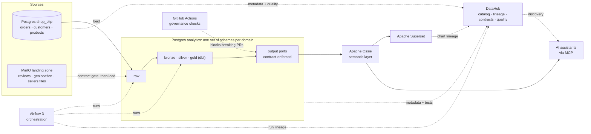

# Data Governance Portfolio: a data mesh on open source

This is a working data platform where governance is part of how things are built, not a review
that happens afterwards. Every dataset, from a file a partner drops in the landing zone to a chart
in a dashboard, has an owning domain, a contract that describes it, quality checks, and lineage you
can follow in the catalog. AI assistants sit on top and can only answer from governed data.

It runs entirely on open-source tools, on the public
[Olist Brazilian E-Commerce dataset](https://www.kaggle.com/datasets/olistbr/brazilian-ecommerce).

> **Built to be promoted, not just demoed.** Locally it runs in Docker. Every component also has a
> documented production configuration and a disaster-recovery plan: see
> [Production readiness](docs/production-readiness.md) and [Disaster recovery](docs/disaster-recovery.md).

---

## How the four data mesh principles show up here

| Principle | What it looks like in this repository |
|---|---|
| **Domain ownership** | Five domains (Sales, Customer, Marketplace, Customer Experience, Reference). Each owns its sources, contracts, dbt project and data products. |
| **Data as a product** | A domain publishes data products. Each has an ODCS contract, an owner, an SLA and named consumers, and appears in DataHub. |
| **Self-serve platform** | `platform/` provides storage, orchestration, ingestion, quality, access control and the catalog. A domain plugs in with configuration and never writes platform code. |
| **Federated computational governance** | `governance/` holds the shared rules as code. CI enforces them on every domain, on every pull request. |

More detail: [docs/data-mesh.md](docs/data-mesh.md).

---

## What it demonstrates

| Capability | How you can see it |
|---|---|
| **Data contracts** | Every governed boundary (landing files, output ports) has an [ODCS](https://bitol-io.github.io/open-data-contract-standard/) contract. |
| **Quality at every layer** | Landing files are checked *before* anything loads, and dbt models are tested against their contracts. |
| **Breaking-change protection** | A pull request that breaks a contract is blocked, and it names the consuming teams. |
| **Lineage across platforms** | In DataHub you can follow a raw file in object storage to the source database, the warehouse and the dashboard. |
| **Shared meaning** | Domains, data products, owners and a business glossary are published to the catalog from the definitions in git. |
| **Governed AI** | An AI assistant gets numbers only from the governed semantic layer, as a least-privilege role. |
| **Production readiness** | Hardened configuration, least-privilege access, backups and a restore drill that is actually run. |

Every row is backed by a scenario you can run: see [Proofs](docs/proofs.md).

---

## Architecture



Each governed fact is written once, and everything else is generated from it (source, compile,
validate, deploy): see [docs/source-compile-deploy.md](docs/source-compile-deploy.md).

Three storage platforms are used on purpose (MinIO for S3, Postgres `shop_oltp`, Postgres
`analytics`), so lineage crosses real platform boundaries, as it does in a company.

---

## Stack

| Layer | Tool | Decision |
|---|---|---|
| Landing zone | [MinIO](https://github.com/minio/minio) (S3-compatible) | [ADR-0024](docs/adr/0024-landing-zone-layout-access-and-lifecycle.md) |
| Operational source | PostgreSQL `shop_oltp` | |
| Warehouse | PostgreSQL `analytics` | [ADR-0012](docs/adr/0012-medallion-and-output-ports.md) |
| Orchestration | [Apache Airflow 3](https://github.com/apache/airflow) | [ADR-0005](docs/adr/0005-airflow-orchestration.md) |
| Pipeline state | Airflow data intervals, an ingestion ledger, write-audit-publish | [ADR-0006](docs/adr/0006-pipeline-state.md) |
| Transformation | [dbt Core](https://github.com/dbt-labs/dbt-core), with [dbt-loom](https://github.com/nicholasyager/dbt-loom) for cross-domain refs | [ADR-0001](docs/adr/0001-dbt-transformation.md) |
| Data contracts | [ODCS](https://github.com/bitol-io/open-data-contract-standard) and [datacontract-cli](https://github.com/datacontract/datacontract-cli) | |
| Catalog | [DataHub](https://github.com/datahub-project/datahub) | [ADR-0018](docs/adr/0018-catalog-deployment-and-catalog-as-code.md) |
| Semantic layer and ontology | [Apache Ossie](https://github.com/apache/ossie) (incubating) | [ADR-0010](docs/adr/0010-semantic-layer-ossie.md), [ADR-0027](docs/adr/0027-business-ontology.md) |
| Reporting | [Apache Superset](https://github.com/apache/superset) | |
| Governed AI | MCP servers: DataHub's, and our own semantic server | [ADR-0020](docs/adr/0020-governed-ai-mcp.md), [ADR-0021](docs/adr/0021-federated-domain-agents.md) |
| Module boundaries | A uv workspace (one package per capability), CODEOWNERS and a CI boundary check | [ADR-0008](docs/adr/0008-monorepo-module-boundaries.md) |
| Cloud portability | S3, SQL and OIDC behind configurable endpoints | [ADR-0009](docs/adr/0009-cloud-portability.md) |
| CI/CD | GitHub Actions | |

All architecture decisions are in [docs/adr/](docs/adr/).

---

## Running it locally

### Prerequisites

| Tool | Notes |
|---|---|
| [Colima](https://github.com/abiosoft/colima), the Docker CLI and the Docker Compose plugin | An open-source container runtime ([ADR-0004](docs/adr/0004-colima-local-runtime.md)). Any Docker-compatible engine works. |
| [uv](https://github.com/astral-sh/uv) | Python environments and dependencies |
| A Kaggle account and API token | To download the Olist dataset |

The full stack (DataHub, Superset, Airflow, MinIO and two Postgres instances) needs a bigger VM
than Colima's default, so use a dedicated profile:

```bash
brew install colima docker docker-compose
colima start governance --cpu 6 --memory 20 --disk 120 --vm-type vz --mount-type virtiofs
docker context use colima-governance
```

### The platform and ingestion

```bash
# 1. Configuration: local defaults. Never commit .env.
cp .env.example .env

# 2. Start the platform: MinIO (landing inbox, archive, state) and two Postgres instances.
#    This creates the buckets, the landing-zone principals, each domain's schemas and roles,
#    and the ingestion ledger.
make up
make verify-infra

# 3. Install the Python workspace (one package per capability).
make install

# 4. Add your Kaggle token so the Olist dataset can be downloaded. Either set
#    KAGGLE_USERNAME / KAGGLE_KEY in .env, or put kaggle.json in ~/.kaggle/.
#    Create one at https://www.kaggle.com/settings -> API -> Create New Token.

# 5. Ingest: download -> seed shop_oltp -> land files -> contract gate -> load raw.
set -a && source .env && set +a
uv run dgp-ingest all
```

After step 5, every dataset is in its domain's `<domain>_raw` schema in the `analytics`
warehouse, and every load is recorded in `platform_meta.ingestion_ledger`. The contract gate drains
landing files from `landing-inbox` into `landing-archive/accepted/` (or `quarantine/`, ADR-0024)
before anything loads, and the load reads accepted files only (ADR-0025). Running it again is
safe: a file whose content was already loaded is skipped, by its SHA-256 (proof P6).

Before every commit, run all the governance and quality checks:

```bash
make check    # every governance policy, then lint, type checks and the test suite
```

### Orchestration with Airflow 3

The same ingestion runs under Airflow as **one DAG bundle per domain** (ADR-0005). A platform
`acquire` DAG publishes the Olist dataset as an asset. Each domain's DAG is triggered by that asset
and seeds, lands and loads only its own datasets.

```bash
make airflow-up       # build the image and start Airflow (run `make up` first)
make airflow-dags     # list the parsed DAGs, one bundle per domain
```

Generate the local Airflow secrets once and put them in `.env` (`AIRFLOW_FERNET_KEY`,
`AIRFLOW_API_SECRET_KEY`, `AIRFLOW_JWT_SECRET`):

```bash
uv run python -c "from cryptography.fernet import Fernet; print('FERNET', Fernet.generate_key().decode())"
python3 -c "import secrets; print('API', secrets.token_hex(32)); print('JWT', secrets.token_hex(32))"
```

Where things are: Airflow at `http://localhost:8080` (no login locally), the MinIO console at
`http://localhost:9001`, `shop_oltp` at `localhost:5432` and `analytics` at `localhost:5433`
(credentials in `.env`).

---

## Repository layout

```
platform/                 The self-serve platform, owned by the platform team (map: platform/README.md)
  access/                 Who may read what: masking, consumer grants, landing-zone policies
  quality/                Is the data right: the quality engine behind the contract gate
  context/                What the data means and where it comes from
    catalog/              DataHub: deployment, ingestion recipes, governance and quality publishing
    semantics/            Apache Ossie: the reader, the bundle build, the Superset publisher, the Visualizer
  core/                   The platform the three pillars govern
    contracts/            The one ODCS contract reader, used everywhere
    ingestion/            Landing zone, contract gate, raw load, ingestion ledger
    transform/            dbt: shared macros, write-audit-publish, generated port metadata, Slim CI
    orchestration/        The Airflow image, DAG factories and platform DAGs
    infra/                Docker Compose (local) and the production configuration
    recovery/             Backups and the restore drill

governance/               Federated governance, owned by the governance guild
  domains/                The domain registry: owners, contacts, alert routes
  tags/                   Governed tags (sensitivity, privacy category), mirrored to warehouse and catalog
  system_columns.yaml     The platform's _system_* columns on every raw table (ADR-0028)
  ontology/               The business ontology (ADR-0027): one Apache Ossie document
  standards/              The standards: data products, breaking changes, the ontology, AI agents
  policies/               The checks that enforce them, run in CI
  approvals/              Consumers' sign-off on breaking changes
  src/dgp_governance/     The library every tool reads these definitions through

domains/<domain>/         Owned by each domain team
  contracts/              ODCS contracts: one per output port
    sources/              What each source delivers into raw (a landing file or an OLTP table)
    dictionary/           The data dictionary: the data elements the domain owns, linked from columns
  ingestion/              Configuration of the domain's sources
  dbt/                    The domain's dbt project
  data_products/          Data product definitions: output ports, SLA, consumers
  semantics/              Apache Ossie semantic models: metrics and dimensions
  pipelines/              The domain's Airflow DAG bundle

reporting/                Superset, the BI consumer
ai/                       Governed AI: the semantic MCP server, domain agents, the router, the eval
proofs/                   One runnable scenario per claim (docs/proofs.md)
docs/                     Architecture, ADRs, production readiness, disaster recovery
```

---

## Roadmap

A milestone is done only when its production-readiness and disaster-recovery items are met too.

- [x] **M1: Platform.** Docker Compose with MinIO, two Postgres instances and Airflow 3, with one
  DAG bundle per domain. Config-driven ingestion downloads the real Olist dataset from Kaggle and
  loads every dataset into `<domain>_raw`, recording each load in an ingestion ledger.
- [x] **M2: Contracts and quality.** ODCS contracts sit at the governed boundaries, not on
  internal layers. Every landing file is validated against its contract and quarantined if it
  fails (proof P2), and CI checks that every landing dataset has a valid contract.
- [x] **M3: Domains.** One dbt project per domain on a medallion (raw → bronze → silver → gold).
  An output port is a model whose ODCS contract carries the `output_port` tag, published in place
  in any layer. Cross-domain refs go through dbt-loom and reach public ports only. Contract quality
  rules are generated into dbt tests, write-audit-publish protects materialized ports (proof P3),
  and consumer grants are generated from the definitions.
- [x] **M4: Catalog.** DataHub (pinned, ADR-0018) with end-to-end and cross-domain lineage
  (proof P7), Airflow lineage at the load boundary, and the domains, data products, owners and
  glossary generated from `governance/` (`make catalog-ingest`, `make catalog-govern`). dbt tests
  appear as assertions, and each dataset links to the Airflow DAG that builds it.
- [x] **M5: Breaking-change gate (proof P5, ADR-0019).** CI blocks a breaking change to an
  output-port contract and names the affected consumers. It passes only with a major version bump
  *and* approval from every consumer, recorded in `governance/approvals/`, and a GitHub workflow asks
  the right teams for review and commits their approval. Consumers that can't cut over at once
  get a versioned port instead. See
  [governance/standards/breaking-changes.md](governance/standards/breaking-changes.md).
- [x] **M6: Reporting and semantics (ADR-0010).** Domains write **Apache Ossie** semantic models
  over their output ports, each metric with one governed definition, and CI keeps them on contract
  columns. They are published to **Superset**, and the charts flow into DataHub, so lineage reaches
  the chart (proof P7).
- [x] **M7: Governed AI.**
  - [x] **The governed boundary (ADR-0020, proof P10).** Any MCP client (Claude, ChatGPT, Copilot,
    Cortex) reaches the mesh through DataHub's MCP server, for discovery, and our semantic MCP
    server, whose only metric tool compiles the domain's Ossie definition into SQL (the same
    reader Superset's publisher uses) and runs it as a consumer role. There is no free-form SQL,
    so ungoverned and PII columns are refused, while `request_semantic_model` turns "please govern
    this" into a request to the owner. Proof P10 shows the AI's number equals Superset's.
  - [x] **Federated domain agents (ADR-0021, proof P11).** The AI layer is a mesh too: one agent
    per domain (the same server scoped by `DGP_SEMANTIC_DOMAIN`), an agent registry derived from
    the definitions, a deterministic router that sends each question to the owning domain, and an
    audit log of every call. Agents follow a standard (`governance/standards/ai-agent.md`), checked
    in CI by `check-ai-agents`.
- [x] **M8: Security and production hardening.**
  - [x] **PII masking by role (ADR-0013, proof P8).** The masking policy is declared on the column
    in ODCS and enforced as a role-aware view (`dgp_platform_access.apply_masking`). End consumers
    connect as a least-privilege `analytics_reader` and see PII masked, while the `compliance` role sees
    the raw value.
  - [x] **Backups and a restore drill with point-in-time recovery (ADR-0022, proof P9).** WAL is
    archived continuously, and the metadata stores are dumped with a checksummed manifest. The
    drill measures RPO on a live write, recovers into an isolated sandbox, rebuilds the warehouse,
    reruns the contract checks and measures each RTO (`make prove-p9`, `make dr-status`).
  - [x] **Hardening, proven on the running stack (ADR-0023, proof P13).** TLS-only Postgres, no
    automation running as the superuser, connection and DDL audit logging, encryption on every
    bucket, no default credentials in production mode, and images and Actions pinned by digest and
    commit SHA.
  - [x] **Landing-zone lifecycle (ADR-0024, proof P14).** A partner-facing inbox (write-only per
    source) and an object-locked archive (`accepted/`, retention-tagged, and `quarantine/` with the
    reason). Partitions follow the contract, access policies are generated from `sources.yml`, and gate
    results reach DataHub as assertions per partition.
  - [x] **The contract gate as its own task (ADR-0025).** `land → contract_gate → load_raw`: the
    gate files every inbox file and loads nothing, and the load picks up accepted files, so it can retry
    without re-checking. Duplicates are detected by a SHA-256 of the content.
  - [x] **Production controls specified, with acceptance tests** (production-readiness §5): TLS
    proxy, SSO, a secrets manager, network isolation, KMS, HA, central logging, alert routing. They
    need infrastructure a laptop can't host, so they are go-live gates.
- [x] **M9: Scaling the transform layer (ADR-0015).** Each dbt model is its own Airflow task
  (Cosmos, manifest mode). Opted-in models get per-model write-audit-publish (proof P15). Every
  publish saves dbt state, and Slim CI builds only what a change touched (proof P16). Microbatch
  ports can be backfilled over an exact window (proof P6).
- [x] **M10: Event-driven ingestion (ADR-0016).** A partner's upload alone runs the pipeline:
  bucket notifications feed an arrival queue that an Airflow `AssetWatcher` reads, and a burst of
  files becomes one run (proof P17). Completion signals, delivery deadlines and alerts to the
  owning domain are covered by proof P18, and a partner-sent checksum is verified by the gate. The
  production bucket policies, KMS keys and secrets inventory are generated from `sources.yml` and
  drift-checked in CI (production-readiness D11/D12).

### Backlog: built when a real need appears, not on a schedule

- [x] **Versioned output ports** (ADR-0019): a new major ships as its own port, `<port>_v<N>`,
  beside the untouched old version, which is deprecated with a sunset date. CI names who still
  reads it once the date passes, and retiring it needs the consumers' sign-off. Built with a worked
  example (`make prove-p19`), since no port has needed it yet.
- **Superset's native semantic-layer connection to Ossie**: *waiting for Superset 7.0.* As of
  2026-10-19 only 7.0 release candidates exist, the feature is behind an experimental flag, and
  there is no Ossie extension yet. When it ships, Superset will read the Ossie definitions live
  instead of a published copy, and the drift check retires.
- [x] **Every proof runnable**: each scenario has a `make prove-p<N>` command. Building them found
  two real defects: transforms waited for *all* their inputs instead of *any*, and rebuilding a view
  dropped the views built on top of it until they were rebuilt.

---

## License

[MIT](LICENSE)
