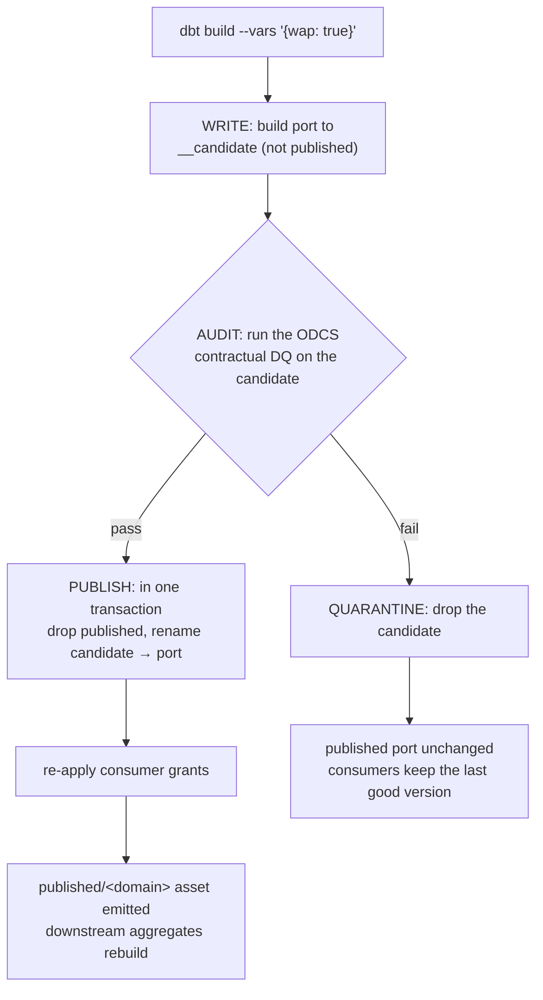

# ADR-0006: Pipeline state management

**Status:** Accepted

## Context
SQLMesh manages state natively: it fingerprints model versions, tracks which time
intervals have been processed, categorises changes as breaking or non-breaking, and
provides virtual environments. dbt Core is largely stateless. The platform still needs to
answer, reliably and after a failure or a disaster:

1. Which runs happened and which failed? *(run state)*
2. Which files and time intervals have been loaded? *(data state)*
3. Which version of each model and contract is live? *(deployment state)*
4. Can a bad build reach consumers? *(publish state)*

## Decision

| State | Owner | Mechanism |
|---|---|---|
| **Run state** | Airflow | DAG runs and task instances in the Airflow metadata DB; every run has a data interval |
| **Data state — files** | Ingestion ledger | `platform_meta.ingestion_ledger` in `analytics`: object key, ETag/checksum, contract version, status (`loaded`, `quarantined`), run id. A file is loaded once; a changed file (new ETag) is detected |
| **Data state — intervals** | Airflow + dbt | Airflow passes its data interval to dbt; incremental models use the `microbatch` strategy (or `delete+insert` on the interval), so reruns and backfills are idempotent |
| **Deployment state** | Git + dbt artifacts | Each production deploy stores `manifest.json` in a versioned MinIO bucket (`platform-state`); CI compares against it (`state:modified`) to build and test only what changed. *Designed here; the bucket is provisioned but the manifest/`state:modified` wiring lands in the [ADR-0015](0015-scaling-the-transform-layer.md) build-out.* |
| **Interface changes** | Contract gate | Breaking changes detected on contracts (output ports) in CI — see the contract gate |
| **Publish state** | Write-audit-publish | A table port builds to a `<name>__candidate` relation, the contract DQ runs on it, then an atomic swap publishes it; a failed check leaves consumers on the last good version. (Opt-in and materialization-aware per [ADR-0014](0014-flexible-write-audit-publish.md); reshaped to a per-model portable promote in [ADR-0015](0015-scaling-the-transform-layer.md).) |

## Comparison with SQLMesh

| SQLMesh native feature | Equivalent here | Gap |
|---|---|---|
| Interval tracking | Airflow data intervals + idempotent incremental models | Backfill coverage is tracked by Airflow runs, not per-model |
| Change categorisation | Contract gate (output ports) + `state:modified` | Only contract-level, not automatic column-level analysis of internal models |
| Virtual environments | Write-audit-publish schema swap | No zero-copy dev environments |
| Plan / apply | PR → CI → merge → deploy | Equivalent |

## Consequences
- The ledger, the Airflow metadata DB and the `platform-state` bucket become backup-critical
  state (see disaster-recovery.md).
- Every load and model must be idempotent: rerunning an interval never duplicates data.
  This is tested in proof P6.

## Write-audit-publish (how it works, proof P3)

A materialized (table) output port is never overwritten in place. The transform builds it to
a `__candidate`, runs the contract's data quality against that candidate, and only an atomic
swap promotes it. A failed audit drops the candidate and leaves the published port — and its
consumers — on the last good version.

Implemented by `platform/transform/publish.py` (`make publish`) and the
`generate_alias_name` macro, per model since ADR-0015 (M9); run per domain by the Airflow
transform DAGs. View ports carry no materialized data to protect and are published in place.
