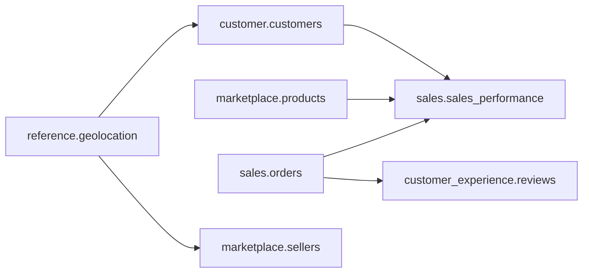

# Data Mesh Design

This document describes how the four data mesh principles are applied, which domain owns
which data, and how domains share data with each other safely.

---

## 1. Domains

The Olist dataset contains nine files. Each one is assigned to exactly one owning domain.

| Domain | Owns (source datasets) | Source system | Data products (output ports) |
|---|---|---|---|
| **Sales** | `orders`, `order_items`, `order_payments` | Postgres `shop_oltp` | `sales.orders`, `sales.order_items`, `sales.sales_performance` |
| **Customer** | `customers` | Postgres `shop_oltp` | `customer.customers` |
| **Marketplace** | `products`, `product_category_name_translation`, `sellers` | `shop_oltp` + landing zone (sellers file) | `marketplace.products`, `marketplace.sellers` |
| **Customer Experience** | `order_reviews` | Landing zone (reviews files) | `customer_experience.reviews`, `customer_experience.review_scores` |
| *Reference (platform)* | `geolocation` | Landing zone | `reference.geolocation` |

Each domain is registered in `governance/domains/` with its owner, team, and contact channel.

### Cross-domain consumption

Domains consume each other's **data products only** — never raw or staging tables.

These dependencies are what the contract gate protects: when Customer changes
`customer.customers` in a breaking way, Sales is the consumer that gets alerted.

---

## 2. Data as a product

A dataset is a **data product** only when it has all of the following. CI rejects a data
product definition that is missing any of them.

| Requirement | Where it lives |
|---|---|
| One-sentence **purpose** (verb + object) and a real **use case** | Data product definition |
| **Type**: source-aligned / aggregate / consumer-aligned | Data product definition |
| Owner (team + accountable person) | Contract `team` section |
| Declared **consumers** | Data product definition |
| ODCS contract with schema and quality rules | `domains/<domain>/contracts/` |
| SLA: freshness and availability | Contract `slaProperties` |
| Classification of every column (public / internal / PII) | Contract column `classification` |
| Semantic version | Contract `version` — major bump required for breaking changes |
| Certification status in DataHub | Set automatically when all quality checks pass |

### Data product heuristics

We apply the [data-mesh-architecture data product heuristics](https://www.datamesh-architecture.com/data-product-heuristics).
They define the standard for *what is a valid data product* and are the basis of
`governance/standards/data-product.md` (some are CI-checkable, some are review guidance):

- **Fundamental:** a clearly defined consumer and use case ("without a use case there is no
  data product"); one stable owner; data quality and semantics **consistent across all output
  ports**; low integration burden (consumers never have to stitch products together for a
  simple question); bounded, maintainable scope.
- **By type:**
  - *Source-aligned* — semantically coherent (one meaning per concept), a single business
    domain, and a contained source **blast radius** (a source change touches only this product).
  - *Aggregate* — build only when **three or more** teams need the same facts; general-purpose
    content only, with dedicated ownership; never a mini-warehouse.
  - *Consumer-aligned* — one decision context, boundaries that follow **process** lines not
    system boundaries, a named business consumer, and only what that team needs.

The **smallest useful standalone unit** wins: decompose by domain/process, not by source
system or artifact type.

---

## 3. Self-serve platform

The platform team owns `platform/`. A domain gets these capabilities without writing
infrastructure code:

| Capability | Domain provides | Platform provides |
|---|---|---|
| Ingestion | A source config in `domains/<domain>/ingestion/` | Loaders, scheduling, lineage emission |
| Quality | Quality rules in its contracts | Test runner, quality gate, results in DataHub |
| Transformation | A dbt project | Airflow integration, write-audit-publish, warehouse roles, CI |
| Cataloging | Contracts and data product definitions | DataHub ingestion, ownership and domain assignment |
| Access | List of consumers | Postgres roles and grants, generated from definitions |

Adding a fifth domain means adding a folder under `domains/` — no platform change.

---

## 4. Federated computational governance

Governance rules are agreed centrally by a governance guild (one representative per
domain plus the platform team) and **enforced as code**, not by review meetings.

| Global policy | Enforced by |
|---|---|
| Every dataset has an ODCS contract with an owner | CI contract validation |
| Every column has a classification; PII columns have a masking rule | CI contract validation |
| Breaking changes need a major version bump and consumer sign-off | CI breaking-change gate |
| Consumers read output ports only | Postgres grants: consumer roles have `SELECT` on output schemas only |
| Data products are certified only when quality checks pass | Quality runner → DataHub certification |
| Shared terms come from the glossary | CI checks glossary references resolve |

Domains stay free to decide everything else: their models, naming inside staging,
release cadence, and tests beyond the global minimum.

### Where "quality" lives

"Quality" is three responsibilities, deliberately kept apart so no layer owns all of it:

| Responsibility | Example | Owner | Location |
|---|---|---|---|
| **The standard** — what quality must mean for everyone | Every data product declares freshness and completeness checks; PII columns have a masking rule; a product is certified only when its checks pass | Governance guild | `governance/standards/`, `governance/policies/` |
| **The mechanism** — the engine that runs checks and blocks a bad load | Test runner, quality gate, assertion results pushed to DataHub | Platform team | `platform/quality/` |
| **The specific rules** — the values for one dataset | `review_score` between 1 and 5; `order_id` not null; freshness ≤ 24 h | The domain | `domains/<domain>/contracts/` (ODCS) |

The platform's quality component is an **engine, not a policy**: it executes whatever rules a
contract declares and enforces the gate. The decision that certain checks are *mandatory*
lives in governance and is enforced in CI against every domain's contract (the rows above).
A domain is free to add stricter checks, never fewer.

### Where contracts live — two governed boundaries

A contract is an agreement at a **boundary where a producer hands data to a consumer**.
There are exactly two such boundaries; the layers in between are internal and carry only
*engineering* quality checks, never a consumer-facing contract.

| Layer | Governed? | Contract | Quality | Consumed by |
|---|---|---|---|---|
| **Landing zone** (files in object storage) | **Yes — governed boundary** | **ODCS** (file contract) | Gate: a file must match its contract **before load**, or it is quarantined (proof P2) | Every domain that ingests the file — governed so all consume the same standardized shape |
| `<domain>_raw`, `<domain>_staging` (internal) | No contract | — | Engineering DQ, owned by the domain (dbt tests) | The owning domain only |
| **Output port** — `<domain>` tables/views | **Yes — governed boundary** | **ODCS** (table/view contract) | Contractual DQ declared in the contract; results visible to consumers | Other domains, BI, AI — output ports only |
| **Semantic output port** | **Yes — governed boundary** | **Apache Ossie** (semantic model) | Definitions resolve to governed concepts | BI and the AI agent (one metric definition for both) |

**Landing is not Raw.** Landing is the shared, governed file boundary where data enters the
platform once and many data products consume it; `<domain>_raw` is each domain's private
copy after ingestion. Governing the landing files with ODCS is what makes consumption
*standardized* across domains.

ODCS therefore applies to **files, tables and views**; Apache Ossie governs the **semantic
model**. Two kinds of quality run on top:

- **Engineering DQ** — internal, per-layer checks the domain owns (dbt tests), for its own
  raw/staging/models. Not visible to consumers.
- **Contractual DQ** — declared in the ODCS contract at a governed boundary, executed by the
  platform, and **visible to consumers** (landing gate results and output-port assertions).

And two kinds of ownership: **technical ownership** of every asset (who operates it) and
**governed product ownership** of a published output port (who is accountable for the promise
to consumers).

---

## 5. Warehouse layout and access

Each domain has its own schemas in the `analytics` database and its own Postgres role.

| Schema | Contents | Who can read |
|---|---|---|
| `<domain>_raw` | Data as loaded from sources | Domain role only |
| `<domain>_staging` | dbt staging models | Domain role only |
| `<domain>` | Data products (output port) | Domain role + declared consumer roles |

Cross-domain dbt references use [dbt-loom](https://github.com/nicholasyager/dbt-loom),
which lets one dbt Core project `ref()` another project's **public** models only —
matching the output-port rule above.
