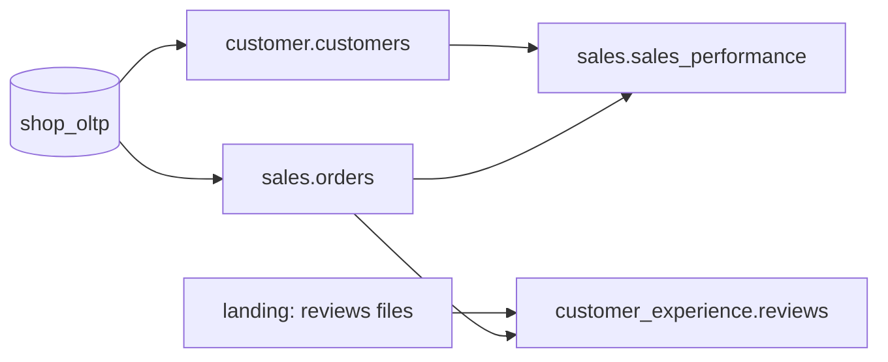

# Proofs — Governance Claims, Demonstrated

Every claim this project makes is backed by a scenario anyone can reproduce with one
command. Each scenario sets up a failure or a change, runs the platform, and checks the
expected outcome automatically.

---

## Production slice

The proofs run on a slice of **four data products across three domains**. It covers both
source types (database and landing-zone files), PII, and cross-domain dependencies.

| Data product | Domain | Source | Consumes | Why it is in the slice |
|---|---|---|---|---|
| `customer.customers` | Customer | `shop_oltp` | `reference.geolocation` | PII columns — masking and access control |
| `sales.orders` | Sales | `shop_oltp` | — | Incremental, high-volume — state and idempotency |
| `customer_experience.reviews` | Customer Experience | Landing zone (files) | `sales.orders` | File quality gate; cross-domain consumer |
| `sales.sales_performance` | Sales | — | `customer.customers`, `sales.orders` | Aggregate consumer — cross-domain trigger and breaking-change target |

Marketplace joins after the slice is proven.

---

## Scenarios

| # | Claim | Scenario | Expected outcome |
|---|---|---|---|
| **P1** | **Domain isolation** — domains deploy and fail independently | Break Customer Experience's pipeline code and its dependencies | Its DAGs fail; Customer and Sales DAGs load, run and publish normally |
| **P2** | **Landing-zone quality gate** — bad files never reach the warehouse | Upload a reviews file that violates its contract (missing column, invalid score, duplicates) | File quarantined, nothing loaded, ledger status `quarantined`, failed assertion visible in DataHub, alert sent |
| **P3** | **Write-audit-publish** — a bad build never reaches consumers | Introduce a transformation bug that breaks a quality rule of `customer.customers` | Build stays in the audit schema; consumers keep reading the last good version; no asset event emitted; downstream DAGs not triggered |
| **P4** | **Cross-domain automation** — consumers react to producers, not to schedules | Publish a new version of `customer.customers` | `sales.sales_performance` rebuilds automatically; nothing else runs |
| **P5** | **Breaking-change gate** — interfaces are protected | Open a PR removing a column from the `customer.customers` contract | CI fails; PR comment lists Sales as the affected consumer; passes only with a major version bump and consumer approval |
| **P6** | **State and idempotency** — reruns and backfills are safe | Rerun the same interval twice; backfill a past month; re-upload an unchanged file | No duplicate rows; backfill fills only the requested range; unchanged file skipped by the ledger |
| **P7** | **End-to-end lineage** — every hop is visible | Run the full pipeline, then query DataHub | Lineage path from landing file / OLTP table → raw → staging → data product → Superset chart |
| **P8** | **Access control** — consumers see output ports only; PII is protected | Query raw/staging schemas and PII columns as a consumer role | Access denied on raw/staging; PII columns masked |
| **P9** | **Disaster recovery** — restores work within RTO | Run the restore drill | Platform rebuilt from backups and git; all quality checks pass; measured recovery time ≤ RTO |

---

## Running the proofs

Each scenario will be runnable with `make prove-<id>` (for example `make prove-p2`), and
`make prove-all` runs the whole suite. The commands are added with the milestone that
delivers each capability.
