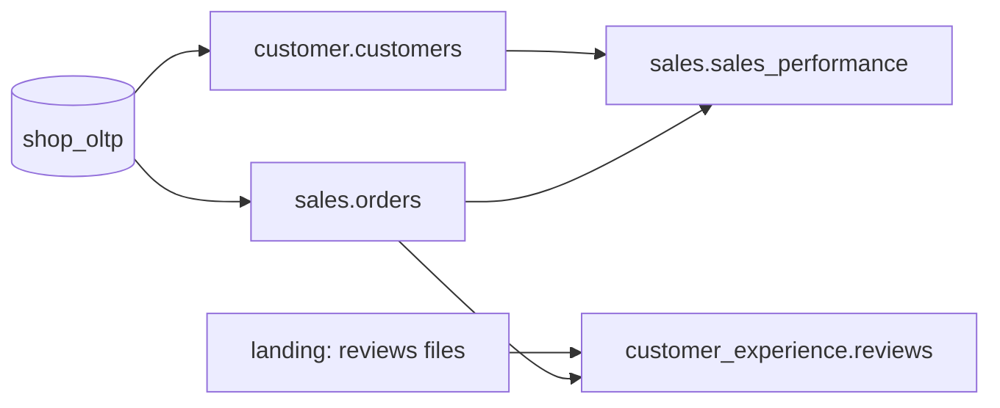

# Proofs — Governance Claims, Demonstrated

Every claim this project makes is backed by a scenario anyone can reproduce with one
command. Each scenario sets up a failure or a change, runs the platform, and checks the
expected outcome automatically.

---

## Production slice

The proofs run on a slice of **four data products across three domains**. It covers both
source types (database and landing-zone files), PII, and cross-domain dependencies.

| Data product | Domain | Source | Consumes | Why it is in the slice |
|---|---|---|---|---|
| `customer.customers` | Customer | `shop_oltp` | `reference.geolocation` | PII columns — masking and access control |
| `sales.orders` | Sales | `shop_oltp` | — | Incremental, high-volume — state and idempotency |
| `customer_experience.reviews` | Customer Experience | Landing zone (files) | `sales.orders` | File quality gate; cross-domain consumer |
| `sales.sales_performance` | Sales | — | `customer.customers`, `sales.orders` | Aggregate consumer — cross-domain trigger and breaking-change target |

Marketplace joins after the slice is proven.

---

## Scenarios

| # | Claim | Scenario | Expected outcome |
|---|---|---|---|
| **P1** | **Domain isolation** — domains deploy and fail independently | Break Customer Experience's pipeline code and its dependencies | Its DAGs fail; Customer and Sales DAGs load, run and publish normally |
| **P2** | **Landing-zone quality gate** — bad files never reach the warehouse | Upload a reviews file that violates its contract (missing column, invalid score, duplicates) | File quarantined, nothing loaded, ledger status `quarantined`, failed assertion visible in DataHub, alert sent |
| **P3** | **Write-audit-publish** — a bad build never reaches consumers | Introduce a transformation bug that breaks a quality rule of `customer.customers` | Build stays in the audit schema; consumers keep reading the last good version; no asset event emitted; downstream DAGs not triggered |
| **P4** | **Cross-domain automation** — consumers react to producers, not to schedules | Publish a new version of `customer.customers` | `sales.sales_performance` rebuilds automatically; nothing else runs |
| **P5** | **Breaking-change gate** — interfaces are protected | Open a PR removing a column from the `customer.customers` contract | CI fails; PR comment lists Sales as the affected consumer; passes only with a major version bump and consumer approval |
| **P6** | **State and idempotency** — reruns and backfills are safe | Rerun the same interval twice; backfill a past month; re-upload an unchanged file | No duplicate rows; backfill fills only the requested range; unchanged file skipped by the ledger |
| **P7** | **End-to-end lineage** — every hop is visible | Run the full pipeline, then query DataHub | Lineage path from landing file / OLTP table → raw → staging → data product → Superset chart |
| **P8** | **Access control** — consumers see output ports only; PII is protected | Query raw/staging schemas and PII columns as a consumer role | Access denied on raw/staging; PII columns masked |
| **P9** | **Disaster recovery** — restores work within RTO | Run the restore drill | Platform rebuilt from backups and git; all quality checks pass; measured recovery time ≤ RTO |
| **P10** | **Governed AI — BI and AI agree** — one definition, computed the same way | Ask the governed semantic MCP (the AI's only metric path) and Superset for each metric; also request an ungoverned/PII column | Identical number from the AI path, Superset and a direct-Ossie control; the ungoverned column is refused ("not in the semantic layer") |
| **P11** | **Agentic mesh** — the AI layer is federated and governable | Scope an agent to one domain and ask for another domain's product; route questions through the orchestrator | A domain agent answers only its own products (isolation); the orchestrator routes each product to its owning domain deterministically; a routed metric equals the direct Ossie number |

---

## Running the proofs

Each scenario becomes a one-command `make prove-<id>`. Self-contained proofs (no running platform)
are built; `make prove-all` runs them:

| Proof | Command | Status |
|---|---|---|
| **P2** — landing quality gate | `make prove-p2` | ✅ runs the real engine on a clean + a contract-violating file |
| **P5** — breaking-change gate | `make prove-p5` | ✅ simulates the PR, asserts blocked → blocked → passes, reverts |
| **P10** — governed AI == BI | `make prove-p10` | ✅ packaged (needs the live platform + `make bi-publish`): asserts AI = Superset = direct-Ossie per metric |
| **P11** — agentic mesh | `make prove-p11` | ✅ packaged: domain isolation + deterministic routing run anywhere; the routed-number check uses the live platform |
| **P8** — access control + PII masking | `make prove-p8` | ✅ packaged (needs the live platform + `make mask`): consumer denied raw/staging + sees masked, compliance sees raw |
| — | `make prove-all` | runs the self-contained proofs (P2, P5) |

The platform-dependent proofs (P3/P6/P7/P10) aren't in `prove-all` (they need a running platform) —
these commands exercise the mechanisms today (platform up — `make up`; catalog for P7 —
`make catalog-up`; Superset for P10 — `make bi-up && make bi-publish`):

| Proof | What it checks | Run it today |
|---|---|---|
| all governance | boundaries, domain registry, contracts, data products, output ports, breaking-change gate, lint, tests | `make check` + `make check-breaking` |
| **P2** — landing quality gate | a bad landing file is quarantined, never loaded | land a contract-violating file, then `uv run dgp-ingest load-raw --domain customer_experience`; check `platform_meta.ingestion_ledger` status `quarantined` |
| **P3** — write-audit-publish | a failing DQ build never reaches consumers | raise a contract's `rowCount` floor above the real count, `make publish`; the port keeps its last-good rows, the candidate is dropped (`QUARANTINED`) |
| **P5** — breaking-change gate | an interface can't break silently | `make prove-p5` (or `make check-breaking` on a branch that edits an output-port contract) |
| **P6** — idempotency | reruns/backfills don't duplicate | re-trigger `<domain>_ingestion`; the ledger skips unchanged files by ETag (no new rows) |
| **P7** — end-to-end lineage | every hop is visible | `make catalog-ingest && make catalog-govern`, then DataHub (`:9002`) or `datahub get --urn <dataset> -a upstreamLineage` |
| **P10** — governed AI == BI | AI and BI compute the same number from one Ossie definition | `make bi-publish`, then `make prove-p10` (the AI path, Superset and a direct-Ossie control agree per metric; ungoverned columns refused) |
| **P11** — agentic mesh | the AI layer is federated, isolated and deterministically routed | `make ai-agents` (the registry), then `make prove-p11` (a domain agent serves only its own products; the orchestrator routes each product to its owner; routed number = direct Ossie) |

**P8** (access control + PII masking) is done (`make prove-p8`, M8); **P9** (restore drill) is the
next M8 slice. **P1** (domain isolation) and **P4** (cross-domain asset trigger) are packaged as
`prove-*` once the harness drives full Airflow (README backlog).
