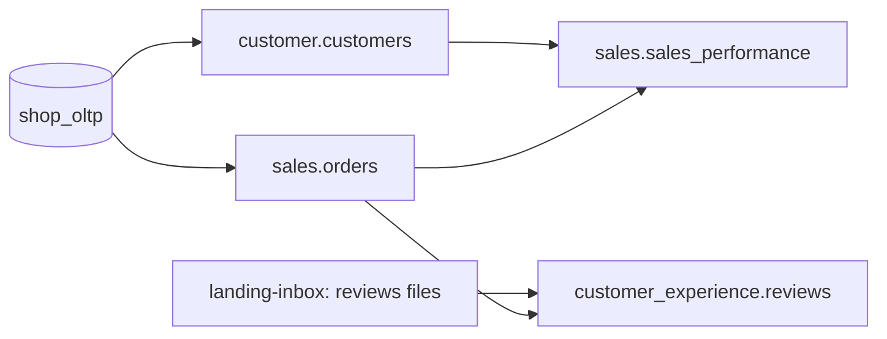

# Proofs — Governance Claims, Demonstrated

Every claim this project makes is backed by a scenario anyone can reproduce with one
command. Each scenario sets up a failure or a change, runs the platform, and checks the
expected outcome automatically.

---

## Production slice

The proofs run on a slice of **four data products across three domains**. It covers both
source types (database and landing-zone files), PII, and cross-domain dependencies.

| Data product | Domain | Source | Consumes | Why it is in the slice |
|---|---|---|---|---|
| `customer.customers` | Customer | `shop_oltp` | `reference.geolocation` | PII columns — masking and access control |
| `sales.orders` | Sales | `shop_oltp` | — | Incremental, high-volume — state and idempotency |
| `customer_experience.reviews` | Customer Experience | Landing zone (files) | `sales.orders` | File quality gate; cross-domain consumer |
| `sales.sales_performance` | Sales | — | `customer.customers`, `sales.orders` | Aggregate consumer — cross-domain trigger and breaking-change target |

Marketplace joins after the slice is proven.

---

## Scenarios

| # | Claim | Scenario | Expected outcome |
|---|---|---|---|
| **P1** | **Domain isolation** — domains deploy and fail independently | Break Customer Experience's pipeline code and its dependencies | Its DAGs fail; Customer and Sales DAGs load, run and publish normally |
| **P2** | **Landing-zone quality gate** — bad files never reach the warehouse | Upload a reviews file that violates its contract (missing column, invalid score, duplicates) | File quarantined, nothing loaded, ledger status `quarantined`, failed assertion visible in DataHub, alert sent |
| **P3** | **Write-audit-publish** — a bad build never reaches consumers | Introduce a transformation bug that breaks a quality rule of `customer.customers` | Build stays in the audit schema; consumers keep reading the last good version; no asset event emitted; downstream DAGs not triggered |
| **P4** | **Cross-domain automation** — consumers react to producers, not to schedules | Publish a new version of `customer.customers` | `sales.sales_performance` rebuilds automatically; nothing else runs |
| **P5** | **Breaking-change gate** — interfaces are protected | Open a PR removing a column from the `customer.customers` contract | CI fails; PR comment lists Sales as the affected consumer; passes only with a major version bump and consumer approval |
| **P6** | **State and idempotency** — reruns and backfills are safe | Rerun the same interval twice; backfill a past month; re-upload an unchanged file | No duplicate rows; backfill fills only the requested range; unchanged file skipped by the ledger |
| **P7** | **End-to-end lineage** — every hop is visible | Run the full pipeline, then query DataHub | Lineage path from landing file / OLTP table → raw → bronze/silver/gold → output port → Superset chart |
| **P8** | **Access control** — consumers see output ports only; PII is protected | Query raw/staging schemas and PII columns as a consumer role | Access denied on raw/staging; PII columns masked |
| **P9** | **Disaster recovery** — restores work within RTO | Run the restore drill | Platform rebuilt from backups and git; all quality checks pass; measured recovery time ≤ RTO |
| **P10** | **Governed AI — BI and AI agree** — one definition, computed the same way | Ask the governed semantic MCP (the AI's only metric path) and Superset for each metric; also request an ungoverned/PII column | Identical number from the AI path, Superset and a direct-Ossie control; the ungoverned column is refused ("not in the semantic layer") |
| **P11** | **Agentic mesh** — the AI layer is federated and governable | Scope an agent to one domain and ask for another domain's product; route questions through the orchestrator | A domain agent answers only its own products (isolation); the orchestrator routes each product to its owning domain deterministically; a routed metric equals the direct Ossie number |
| **P21** | **Governed analyst session** — in Claude Code, governance holds without the right prompt wording | Start `make ai-chat`; inspect what the session is launched with; weaken its settings or inline a password; ask a real session to print `.env`, the raw customer CSV and `customer_unique_id` values | Session env holds only allow-listed variables (no `.env` secret; the warehouse URI is `analytics_reader` over verify-full TLS); shell, edits and reads of secrets/raw data are denied; only the governed MCP servers load; the session gets the analyst prompt; no DataHub recipe profiles with sample values; every weakening is caught; the live session prints no secret and no raw row |
| **P14** | **Landing-zone lifecycle** — every partner file is filed, explained and visible | A partner delivers a contract-violating file, a misnamed file, a good file, and the same file twice | Bad files go to `quarantine/` with `_reason.json` and are never loaded; the good file goes to `accepted/` (partition from the file name, object-locked, retention-tagged) and is loaded; the resend is skipped; the inbox is always drained; the partner is write-only to its own prefix; DataHub shows each rule's FAILURE/SUCCESS per partition on the landing dataset |
| **P13** | **Production hardening** — controls hold on the running stack | Connect without TLS; inspect roles, logs, objects; run the prod preflight | Plain TCP refused, verify-full over TLS, no superuser/CREATEROLE in automation roles, catalog reader can't write, connections + DDL logged, every object encrypted, dev credentials refused in prod mode, everything pinned, DR fresh |
| **P12** | **Output-port completeness** — consumers and AI agents never read an undocumented port | Strip a column's description and a column's classification (from the column and the definition it inherits from), the table description, and a metric's description | Each is blocked in CI (`check-output-ports` / `check-semantics`) naming the missing item; the documented ports pass |
| **P15** | **Per-model write-audit-publish** — one bad model never reaches consumers, and publishing never breaks what depends on a port | A consumer view on a port; a batch with a null key; a batch that is clean alone but duplicates an order elsewhere; the same in Airflow | The port is replaced in place (same table, view, grants, docs intact); both bad batches are quarantined with the failing rule named, the port keeps its last good rows, nothing is built from it, and in Airflow `save_state` (the only `published/<domain>` outlet) does not run |
| **P16** | **dbt state + Slim CI** — a change builds only what it touched | No change; an edit to a leaf model; an edit to an upstream model; the same against a git ref | 0 models; exactly the edited model, built in the `<domain>_ci` sandbox with its upstream deferred to the published relation and the published port untouched; the model + its descendants only; the same plan with no warehouse |
| **P17** | **Event-driven ingestion** — an arrival runs the pipeline; a burst runs it once | A partner uploads 5 files within a second (one with its own SHA-256, 4 misnamed); then the real file | One arrival-triggered run gates all 5 (no manual trigger); the checksum is verified; the good file is loaded, the 4 quarantined and alerted; inbox drained, queue acked; DataHub dates the delivery from its arrival; the SLA monitor runs |
| **P18** | **Completion signals, deadlines, alerts** — partial, rejected and missing deliveries are caught | `expected_files: 2` with one part, then both; a batch with one bad part; a `marker` batch; a partition nothing arrived for | Part 1 waits and is reported `incomplete` at its deadline (one alert on the owner's webhook); both parts are accepted and loaded as one batch; one bad part quarantines the whole batch with one reason; data waits for the marker, which is consumed; the empty partition is reported `missing` |
| **P19** | **Versioned output port** — a breaking change ships without breaking anyone | Release `customers_v2` (drops a column) beside v1; let the sunset pass; retire v1 early; migrate sales; retire with sign-off | Release needs no approval and every check passes; both versions served, v2 masked + granted; after the sunset CI names sales; early retirement blocked; sales rebuilds on v2 with the same numbers; retirement passes only with the consumers' sign-off |

---

## Running the proofs

Each scenario becomes a one-command `make prove-<id>`. Self-contained proofs (no running platform)
are built; `make prove-all` runs them:

| Proof | Command | Status |
|---|---|---|
| **P2** — landing quality gate | `make prove-p2` | ✅ runs the real engine on a clean + a contract-violating file |
| **P5** — breaking-change gate | `make prove-p5` | ✅ simulates the PR, asserts blocked → blocked → passes, reverts |
| **P10** — governed AI == BI | `make prove-p10` | ✅ packaged (needs the live platform + `make bi-publish`): asserts AI = Superset = direct-Ossie per metric; a PII column, an invented metric and an ungoverned product are refused |
| **P21** — governed analyst session | `make prove-p21` | ✅ self-contained: runs the real `make ai-chat` launcher with a stub, checks env, flags (incl. the analyst prompt), deny rules, MCP config and DataHub recipes (no sample values), and that each weakening is caught; `P21_LIVE=1` adds a real headless Claude session |
| **P11** — agentic mesh | `make prove-p11` | ✅ packaged: domain isolation + deterministic routing run anywhere; the routed-number check uses the live platform |
| **P12** — output-port completeness | `make prove-p12` | ✅ strips documentation from the real contract, its definitions and the Ossie model, asserts each CI gate blocks, reverts |
| **P1** — domain isolation | `make prove-p1` | ✅ packaged (live + Airflow): a domain's broken DAG code shows import errors only in its bundle; its broken model fails only its transform, its port keeps the last good version, its consumer still builds; it recovers |
| **P4** — cross-domain automation | `make prove-p4` | ✅ packaged (live + Airflow): republishing `customer` triggers `sales_transform` through `published/customer`, which rebuilds `sales_performance`; no other domain DAG runs |
| **P6** — state and idempotency | `make prove-p6` | ✅ packaged (live): a backfill rewrites exactly its window (by row version), nothing else; a rerun is idempotent; file dedup in P14 |
| **P15** — per-model WAP | `make prove-p15` | ✅ packaged (live): in-place promote keeps dependents + grants; null key and cross-batch duplicate quarantined; the Airflow DAG quarantines and emits no `published/sales` |
| **P16** — dbt state + Slim CI | `make prove-p16` | ✅ packaged (live): plans + builds only `state:modified+` in a sandbox with `--defer`; the git-baseline plan CI runs |
| **P17** — event-driven ingestion | `make prove-p17` | ✅ packaged (live + Airflow): upload → arrival trigger → one run per burst, verified, alerted, acked, dated in DataHub |
| **P19** — versioned output port | `make prove-p19` | ✅ packaged (live): release → both served → sunset → blocked early retirement → migrate → approved retirement; reverted |
| **P18** — completion signals + deadlines | `make prove-p18` | ✅ packaged (live): `expected_files` / `marker` batches, whole-batch quarantine, `incomplete` / `missing` at the deadline, one alert per condition on the owner's webhook |
| **P8** — access control + PII masking | `make prove-p8` | ✅ packaged (needs the live platform + `make mask`): consumer denied raw/staging + sees masked, compliance sees raw |
| **P9** — disaster recovery | `make prove-p9` | ✅ packaged (needs the live platform): RPO measured on a live write → PITR of shop_oltp + restore of metadata stores in an isolated sandbox → rebuild analytics → all contract checks + P8 → every RTO met |
| **P13** — production hardening | `make prove-p13` | ✅ packaged (needs the live platform): TLS-only Postgres, least-privilege roles, audit logging, encryption at rest, X2/X8/X10 gates |
| — | `make prove-all` | runs the self-contained proofs (P2, P5, P12, P21) |

The platform-dependent proofs (P3/P6/P7/P10) aren't in `prove-all` (they need a running platform) —
these commands exercise the mechanisms today (platform up — `make up`; catalog for P7 —
`make catalog-up`; Superset for P10 — `make bi-up && make bi-publish`):

| Proof | What it checks | Run it today |
|---|---|---|
| all governance | boundaries, domain registry, contracts, data products, output ports, breaking-change gate, lint, tests | `make check` + `make check-breaking` |
| **P2** — landing quality gate | a bad landing file is quarantined, never loaded | `make prove-p2` (engine), and end to end on the live platform with `make prove-p14` |
| **P14** — landing lifecycle | inbox → accepted/quarantine → DataHub, least-privilege access | `make up` (buckets + principals), `make catalog-up`, then `make prove-p14`. By hand: drop a file in `landing-inbox/olist/reviews/` (S3 browser `:9001`), run `uv run dgp-ingest gate --domain customer_experience` (the check; loads nothing — with Airflow up the upload itself fires the domain DAG, P17), look in `landing-archive/quarantine/…/_reason.json` or `accepted/…`, then `make catalog-quality` (automatic when the run is the Airflow `<domain>_ingestion` DAG) and open the landing dataset's **Quality** tab in DataHub (`:9002`); `uv run dgp-ingest load-raw --domain customer_experience` then loads what was accepted |
| **P3** — write-audit-publish | a failing DQ build never reaches consumers | packaged per model as `make prove-p15` (CLI + Airflow). By hand: raise a contract's `rowCount` floor above the real count, `make publish`; the port keeps its last-good rows, the candidate is dropped (`QUARANTINED`) |
| **P5** — breaking-change gate | an interface can't break silently | `make prove-p5` (or `make check-breaking` on a branch that edits an output-port contract) |
| **P6** — idempotency | reruns/backfills don't duplicate | `make prove-p6` (backfill a window, rerun it) and re-deliver an unchanged file: the gate records `skipped` (same content SHA-256 as the dataset's latest accepted file, whatever the upload method) and drains the inbox (asserted in `make prove-p14`) |
| **P7** — end-to-end lineage | every hop is visible | `make catalog-ingest && make catalog-govern`, then DataHub (`:9002`) or `datahub get --urn <dataset> -a upstreamLineage` |
| **P10** — governed AI == BI | AI and BI compute the same number from one Ossie definition | `make bi-publish`, then `make prove-p10` (the AI path, Superset and a direct-Ossie control agree per metric; ungoverned columns refused) |
| **P11** — agentic mesh | the AI layer is federated, isolated and deterministically routed | `make ai-agents` (the registry), then `make prove-p11` (a domain agent serves only its own products; the orchestrator routes each product to its owner; routed number = direct Ossie) |

**P8** (access control + PII masking), **P9** (restore drill with PITR) and **P13** (hardening) are
done (`make prove-p8`, `make prove-p9`, `make prove-p13`, M8). P11 now also asserts agent isolation in
the warehouse (each `agent_<domain>` role is denied other domains' ports). **P1** (domain isolation)
and **P4** (cross-domain asset trigger) are packaged too (`make prove-p1`, `make prove-p4`); every
proof in the scenario table now has a command.
